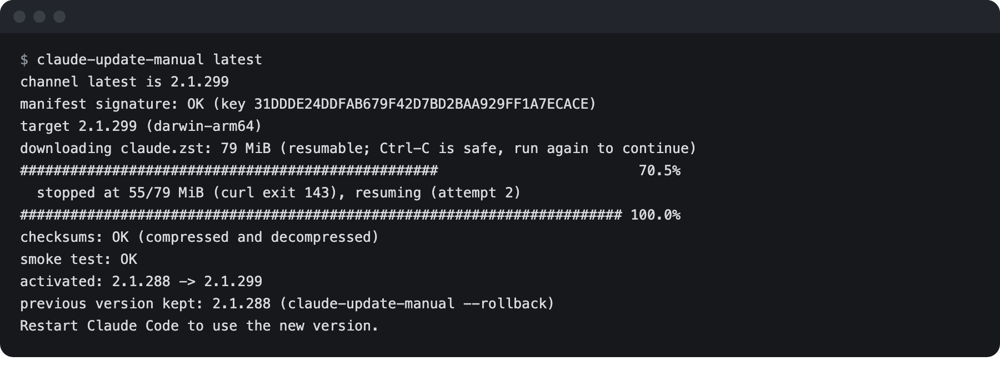
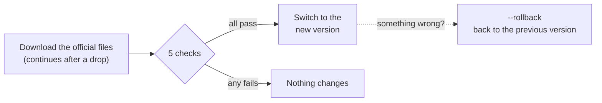

# claude-update-manual

**English** | [中文](README.zh-CN.md)

Update Claude Code on a slow or unstable connection.

Claude Code's built-in updater downloads each new version in one go and gives
up after 10 minutes, so on a slow or proxied connection it may never finish.
This script downloads the same official files, picks up where it left off when
the connection drops, and checks Anthropic's signature before it switches you
to the new version.

> [!NOTE]
> Unofficial and not affiliated with Anthropic. It's a stopgap until
> [anthropics/claude-code#85046](https://github.com/anthropics/claude-code/issues/85046)
> is fixed. If you installed Claude Code with Homebrew, apt or dnf, you don't
> need it.

<p align="center">
  
</p>
<p align="center"><sub>A real run on 2026-10-14. At about 65 KB/s the download took 21 minutes, twice the built-in updater's 10-minute limit. To simulate a dropped connection I stopped curl by hand at 55 MiB (hence <code>curl exit 143</code>; the shell's one-line kill notice is left out), and it carried on from there.</sub></p>

## Quick start

1. Download `claude-update-manual` and `SHA256SUMS` from the
   [latest release](https://github.com/kuk1song/claude-update-manual/releases/latest), then:

   ```bash
   shasum -a 256 -c SHA256SUMS        # on Linux: sha256sum -c SHA256SUMS
   install -m 755 claude-update-manual ~/.local/bin/
   ```

2. Stop the built-in updater from retrying. Add this to `~/.claude/settings.json`:

   ```json
   { "env": { "DISABLE_AUTOUPDATER": "1" } }
   ```

3. Update:

   ```bash
   claude-update-manual
   ```

   Ctrl-C is safe at any point; run it again and it continues. Restart Claude
   Code afterwards to use the new version.

## Do you need it?

| How you installed Claude Code | Does a dropped download resume? | Use this? |
|---|---|---|
| `curl -fsSL https://claude.ai/install.sh \| bash` (Anthropic's "Native Install") | No, and it stops after 10 minutes | Yes, if updates keep failing |
| Homebrew | Yes, run `brew upgrade` again | No |
| apt or dnf | Yes | No |
| npm | No, but it only times out when the download stalls | Usually not |

## How it works



The 5 checks, in order:

1. The list of files carries Anthropic's signature (this needs `gpgv`).
2. The list is for the version you asked for.
3. The download matches the checksum on the list.
4. On macOS, the program is signed with Anthropic's Developer ID.
5. The new program starts and reports the expected version.

Old versions stay on disk, so `--rollback` works offline. This tool never
deletes anything.

## Commands

| Command | What it does |
|---|---|
| `claude-update-manual` | Update to the newest version |
| `claude-update-manual stable` | Update to the stable channel, about a week behind |
| `claude-update-manual 2.1.299` | Install an exact version |
| `claude-update-manual --rollback` | Go back to the version you had before |
| `claude-update-manual --check` | Show what you have and what's available |

## More details

<details>
<summary><b>Behind a proxy</b></summary>

curl reads `HTTPS_PROXY` or `ALL_PROXY`, for example
`export HTTPS_PROXY=http://127.0.0.1:7890`. If your proxy runs in TUN mode,
you don't need to set anything.
</details>

<details>
<summary><b>A note when a new version is out</b></summary>

Add this to `~/.claude/settings.json` to see a one-line note at the start of a
session when a newer version exists. It checks the network at most once a day,
waits at most 3 seconds, and follows your `autoUpdatesChannel` setting.

```json
{
  "hooks": {
    "SessionStart": [
      { "hooks": [ { "type": "command", "command": "$HOME/.local/bin/claude-update-manual --hook", "timeout": 8 } ] }
    ]
  }
}
```
</details>

<details>
<summary><b>What you need installed</b></summary>

macOS or Linux, bash 3.2 or later, `curl` and `python3`. Recommended:

- `zstd`: fetches the compressed build, 83 MB instead of 248 MB for 2.1.299 on Apple Silicon.
- `gpgv`: checks the signature. Debian and Ubuntu usually have it; on macOS, `brew install gnupg`.

Without `gpgv`, macOS still gets the Developer ID check (step 4). On Linux
you'd be relying on HTTPS and the checksum, which is what Anthropic's own
installer does.
</details>

<details>
<summary><b>Settings it respects</b></summary>

It won't run if `DISABLE_UPDATES` is set. It follows `minimumVersion`,
`requiredMinimumVersion` and `requiredMaximumVersion` from
`~/.claude/settings.json` and `managed-settings.json`, and stops if it can't
read them. It doesn't read `managed-settings.d/`, MDM profiles or
server-managed settings.

It only touches the launcher that Anthropic's installer creates
(`~/.local/bin/claude`, a link into `~/.local/share/claude/versions/`). A
custom launcher is left alone. Only one copy runs at a time.
</details>

<details>
<summary><b>Disk space</b></summary>

Each version in `~/.local/share/claude/versions/` is about 250 MB. You can
delete old ones, but not the one `~/.local/bin/claude` points to. Note that
`claude update` may delete old versions on its own: it keeps the two newest
and the one in use.
</details>

<details>
<summary><b>Verify this download</b></summary>

`SHA256SUMS` comes with every release. Each release also has a build
attestation you can check with
`gh attestation verify claude-update-manual --repo kuk1song/claude-update-manual`.
</details>

<details>
<summary><b>Technical notes</b></summary>

- Resuming uses HTTP range requests. The loop stops only after five passes in
  a row make no progress, so a proxy that cuts long connections every few
  seconds is fine.
- The signing key is pinned by fingerprint
  `31DD DE24 DDFA B679 F42D 7BD2 BAA9 29FF 1A7E CACE`, from
  [Anthropic's setup guide](https://code.claude.com/docs/en/setup).
  Releases are signed from 2.1.89 on.
- The new binary is copied next to its final location, checked there, and
  moved into place with a rename; the launcher is switched the same way.
</details>

<details>
<summary><b>Tests</b></summary>

```bash
tests/run.sh    # 44 checks against a local mock server (39 without gpg), all inside a temp dir
tests/live.sh   # read-only: checks the real latest signature and your installed binary
```

`run.sh` covers dropped and stalled downloads, bad checksums and signatures, a
file list for the wrong version, a binary that won't start, rollback, locking,
the settings above and the session note. CI runs it on Ubuntu and macOS,
including the bash 3.2 that ships with macOS.
</details>

## License

MIT
